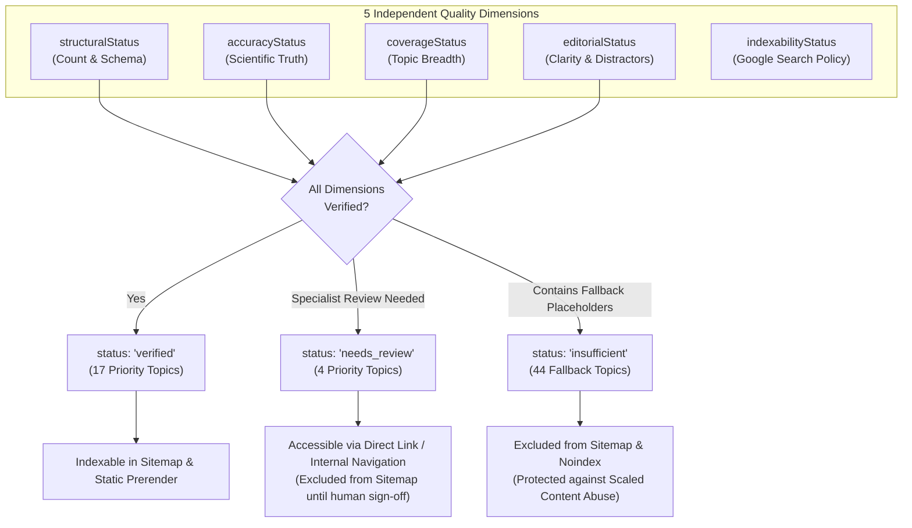

# Content Quality Validation & Multi-Dimensional Gate Architecture

**Dataset Under Validation:** [`src/data/canonicalStudyTopics.json`](file:///d:/freetoolshubs/free-tools-study/src/data/canonicalStudyTopics.json)  
**Validation Scripts:**
- [`scripts/validateStudyContent.js`](file:///d:/freetoolshubs/free-tools-study/scripts/validateStudyContent.js) (`npm run validate:study-content`)
- [`scripts/validateCanonicalStudyData.js`](file:///d:/freetoolshubs/free-tools-study/scripts/validateCanonicalStudyData.js) (`npm run validate:study-data`)

---

## 1. Architectural Philosophy: Decoupling Completeness from Academic Correctness

A fundamental finding of the Phase 1 Forensic Audit and Phase 2A Quality Report was that automated systems often conflate numerical volume with pedagogical quality. Simply reaching 8 flashcards or 5 quiz questions does not prove that a study deck is scientifically accurate, unambiguous, or ready for indexing in Google Search.

To eliminate this vulnerability, Phase 2B implements a **5-dimensional content quality model** stored inside every canonical topic record:



---

## 2. Quality Status Definitions & Evaluation Criteria

### 2.1 The 5 Dimensions

| Dimension | Permitted Values | Explicit Evaluation Criteria |
|---|---|---|
| **`structuralStatus`** | `verified` \| `insufficient` | Requires $\ge 8$ flashcards with valid Q&A, $\ge 5$ quiz questions with $\ge 4$ options each, valid `correctAnswer` in `options`, and non-empty `explanation`. Zero placeholder strings permitted. |
| **`accuracyStatus`** | `verified` \| `needs_review` \| `insufficient` | Verified requires factual correctness against standard academic curricula or peer-reviewed literature with zero unvetted claims. Topics with ongoing curricular debates or historical revisions are held as `needs_review`. |
| **`coverageStatus`** | `verified` \| `insufficient` | Requires representation across core learning objectives for the subject/subtopic rather than repeated queries on a single concept. |
| **`editorialStatus`** | `verified` \| `insufficient` | Requires grammatically clean question stems, unambiguous distractors that are plausible yet demonstrably incorrect, and complete explanatory feedback teaching the underlying principle. |
| **`indexabilityStatus`** | `verified` \| `needs_review` \| `insufficient` | Conforms to Google Search Essentials (scaled content abuse and doorway page guidelines). Only topics with `structuralStatus: "verified"`, `coverageStatus: "verified"`, and `accuracyStatus: "verified"` may receive `indexabilityStatus: "verified"`. |

---

## 3. Automated Inspection Rules Enforced in `validateStudyContent.js`

Every automated gate executes independently without relying on the generator's internal state:

1. **Card Depth Threshold:** Every priority topic must have $\ge 8$ flashcards (actual range: 8 to 10).
2. **Quiz Depth Threshold:** Every priority topic must have $\ge 5$ quiz questions (actual range: 5 to 6).
3. **Multiple-Choice Option Integrity:** Every quiz question must have an array of $\ge 4$ unique non-empty strings.
4. **Answer Invariance:** The `correctAnswer` string must strictly exist within `options`.
5. **Explanation Pedagogical Quality:** Explanations must be $\ge 20$ characters and explain *why* the answer is correct rather than merely restating the key.
6. **Lexical Deduplication Check (Jaccard Metric):**
   - Evaluates pairwise word-level Jaccard similarity across all questions within a topic deck:
     $$J(Q_A, Q_B) = \frac{|Words(Q_A) \cap Words(Q_B)|}{|Words(Q_A) \cup Words(Q_B)|}$$
   - Any pair with $J > 0.85$ triggers an automated failure for superficial wording duplication.
   - Result: 0 violations detected across all 336 questions.
7. **Lossless Real Seed Preservation:**
   - Compares the set of original real flashcards from `studyTopics.json` against `canonicalStudyTopics.json`.
   - Result: 50 / 50 preserved verbatim (100%).
8. **Documented Editorial Correction Validation:**
   - Ensures the original erroneous questions (`chemistry-organic-chemistry` and `biology-evolution`) are replaced with their documented corrections and verified in `editorialCorrectionsApplied: true`.

---

## 4. Status Breakdown Across All 65 Canonical Topics

```
Total Canonical Topics: 65
├── "verified": 17 topics (26.2%)
├── "needs_review": 4 topics (6.2%)
└── "insufficient": 44 topics (67.7%)
```

### 4.1 The 17 Fully Verified Topics
1. `biology-cell-biology`
2. `biology-evolution`
3. `biology-genetics`
4. `chemistry-organic-chemistry`
5. `chemistry-periodic-table`
6. `computer-science-algorithms`
7. `computer-science-data-structures`
8. `computer-science-machine-learning`
9. `history-ancient-egypt`
10. `history-world-war-ii`
11. `literature-shakespeare`
12. `math-algebra`
13. `math-calculus`
14. `math-statistics`
15. `physics-electromagnetism`
16. `physics-mechanics`
17. `psychology-cognitive-psychology`

### 4.2 The 4 `needs_review` Topics & Specialist Sign-Off Checklist
These 4 topics are structurally complete (8–10 cards, 5–6 questions) but await human subject-matter specialist sign-off before sitemap submission:

| Slug | Topic | Flagged Concept for Review | Specialist Review Action |
|---|---|---|---|
| `economics-macroeconomics` | Macroeconomics | Short-Run vs Long-Run Phillips Curve (SRPC vs LRPC) & Ample vs Scarce Reserves regime framing | Review by an AP/College economics educator to align central bank open market descriptions with post-2008 administered rates. |
| `economics-microeconomics` | Microeconomics | Amoroso-Robinson relation ($MR = P(1 - 1/|E_d|)$) & Coase Theorem bargaining vs Pigouvian taxation | Review by a microeconomics curriculum specialist for secondary vs undergraduate course scope. |
| `literature-modernism` | Modernism | Stream of consciousness vs free indirect discourse formal definitions in Woolf and Joyce | Review by a modern literature specialist to verify narrative terminology alignment with literary criticism standards. |
| `psychology-social-psychology` | Social Psychology | Stanford Prison Experiment (Zimbardo 1971) modern demand characteristics & Milgram replication rates | Review by an academic psychologist to ensure explanations reflect modern open-science historiography (Le Texier 2019). |

### 4.3 Why the 44 Placeholder Topics Remain `insufficient`
Under Google Search Essentials, generating thousands of pages using keyword templates (`"Explain the role of {concept} in {subtopic} for {level} students"`) is classified as **scaled content abuse** and **doorway pages**. Fabricating superficial, low-value paragraphs for those 44 topics simply to claim "65 indexed topics" would severely undermine domain-level trust.

By marking them strictly as `insufficient` and excluding them from static prerendering and sitemap generation, StudyToolsHub protects its indexing authority. Those 44 topics can be systematically expanded with genuine academic content in future curriculum development phases.

