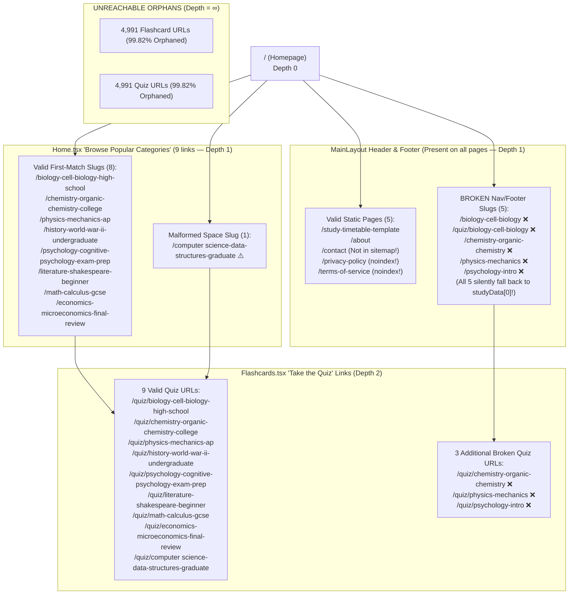

# Crawl Discovery, Internal Linking, Sitemap & Canonical Strategy

**Target Property:** `https://study.freetoolshubs.com/`  
**Source Repository:** `d:/freetoolshubs/free-tools-study`  
**Evidence Classification:** `VERIFIED_SOURCE` and `VERIFIED_PRODUCTION` (reproduced via `audit.py` and `crawl_and_bundle_analysis.py`).

---

## 1. Current URL Inventory & Sitemap Reconciliation (`VERIFIED_SOURCE` + `VERIFIED_PRODUCTION`)

### 1.1 Exact Sitemap Breakdown (`public/sitemap.xml` vs. Live Production)
Both `public/sitemap.xml` (1,734,249 bytes CRLF) and live `https://study.freetoolshubs.com/sitemap.xml` (1,684,222 bytes LF) contain **10,005 `<url>` entries**:

| URL Category | Count in `sitemap.xml` | `<priority>` | `<changefreq>` | `<lastmod>` Present? | Critical Audit Findings (`VERIFIED_SOURCE`) |
|---|---:|---:|---|---|---|
| **Static Pages** | **5** | `1.0` | `weekly` | ❌ No | Includes `/`, `/study-timetable-template`, `/about`, `/privacy-policy`, `/terms-of-service`. **Defect 1:** `/privacy-policy` and `/terms-of-service` have `<meta name="robots" content="noindex" />` in their React components (`PrivacyPolicy.tsx` line 9, `TermsOfService.tsx` line 9). **Defect 2:** `/contact` (`Contact.tsx`, indexable) is **missing** from `sitemap.xml`. |
| **Flashcard Topic URLs (`/:slug`)** | **5,000** | `0.9` | `monthly` | ❌ No | **Defect 3:** **555 URLs** (`Computer Science` records) contain an **unencoded literal space** (`https://study.freetoolshubs.com/computer science-...`), violating XML Sitemap / RFC 3986 standards. **Defect 4:** **3,895 URLs** are pure cycle-repeat duplicates (`-v1`..`-v9`). **Defect 5:** **3,536 URLs** contain synthetic placeholder text (`generateFallbackContent`). |
| **Quiz Topic URLs (`/quiz/:slug`)** | **5,000** | `0.7` | `monthly` | ❌ No | Same 555 unencoded-space URLs (`https://study.freetoolshubs.com/quiz/computer science-...`), 3,895 cycle-repeat duplicates, and 3,536 synthetic placeholder quizzes with literal options `"Common student misconception"` and `"Irrelevant distractor"`. |
| **Planner Exam URLs (`/planner/:examType`)** | **0** | — | — | — | Route `/planner/:examType` exists in `App.tsx` line 40, is commented out in `scripts/generateSEOFiles.js` line 42, and has **0 internal links** anywhere in the app. |
| **Total** | **10,005** | — | — | **0 / 10,005** | **0% of URLs have `<lastmod>`; 11.09% (1,110 URLs) are malformed URIs with spaces; 99.77% (9,982 URLs) are complete orphans.** |

---

## 2. Internal Link Graph & Orphan Analysis (`VERIFIED_SOURCE`)

### 2.1 Complete Pre-JS vs. Post-JS Link Graph
1. **Before JavaScript Execution (`index.html`):**
   - Outgoing `<a href>` links from `/`: **0**.
   - Reachable pages without JavaScript: **1** (only the requested URL itself, as an empty shell).
2. **After JavaScript Execution (Full BFS Traversal from `/` via `crawl_and_bundle_analysis.py`):**
   - Out of **10,005 sitemap URLs**, a crawler starting at `/` and following every rendered `<Link to="...">` (`<a href="...">`) across the entire site can only ever reach **32 unique URLs total**, and **8 of those 32 URLs are broken slugs that do not exist in `studyTopics.json`!**



### 2.2 Complete Inventory of the 32 Reachable URLs from `/`

| Crawl Depth | URL Path | Exists in `studyTopics.json`? | Exists in `sitemap.xml`? | Actual Behavior (`VERIFIED_SOURCE`) |
|---:|---|---|---|---|
| 0 | `/` | Static Route | ✅ Yes | Renders Homepage (no `<Helmet>`, no canonical). |
| 1 | `/study-timetable-template` | Static Route | ✅ Yes | Renders Planner (no `<Helmet>`, no canonical). |
| 1 | `/about` | Static Route | ✅ Yes | Renders About page (no canonical). |
| 1 | `/contact` | Static Route | ❌ **No** | Renders Contact page (no canonical; omitted from sitemap). |
| 1 | `/privacy-policy` | Static Route | ✅ Yes (Conflict!) | Renders Privacy Policy with `<meta name="robots" content="noindex" />`. |
| 1 | `/terms-of-service` | Static Route | ✅ Yes (Conflict!) | Renders Terms of Service with `<meta name="robots" content="noindex" />`. |
| 1 | `/biology-cell-biology` | ❌ **No** | ❌ No | **Broken Header/Hero/Footer link.** Silently renders `biology-cell-biology-high-school` with self-canonical `/biology-cell-biology`. |
| 1 | `/quiz/biology-cell-biology` | ❌ **No** | ❌ No | **Broken Header/Hero/Footer link.** Silently renders `biology-cell-biology-high-school` quiz with self-canonical `/quiz/biology-cell-biology`. |
| 1 | `/chemistry-organic-chemistry` | ❌ **No** | ❌ No | **Broken Footer link ("Chemistry").** Silently renders **Biology (Cell Biology)** flashcards with canonical `/chemistry-organic-chemistry`! |
| 1 | `/physics-mechanics` | ❌ **No** | ❌ No | **Broken Footer link ("Physics").** Silently renders **Biology (Cell Biology)** flashcards with canonical `/physics-mechanics`! |
| 1 | `/psychology-intro` | ❌ **No** | ❌ No | **Broken Footer link ("Psychology").** Silently renders **Biology (Cell Biology)** flashcards with canonical `/psychology-intro`! |
| 1 | `/biology-cell-biology-high-school` | ✅ Yes (`study-00000`) | ✅ Yes | Valid Biology category link from `Home.tsx`. |
| 1 | `/chemistry-organic-chemistry-college` | ✅ Yes (`study-00001`) | ✅ Yes | Valid Chemistry category link from `Home.tsx`. |
| 1 | `/physics-mechanics-ap` | ✅ Yes (`study-00002`) | ✅ Yes | Valid Physics category link from `Home.tsx`. |
| 1 | `/math-calculus-gcse` | ✅ Yes (`study-00003`) | ✅ Yes | Valid Math category link from `Home.tsx`. |
| 1 | `/history-world-war-ii-undergraduate` | ✅ Yes (`study-00004`) | ✅ Yes | Valid History category link from `Home.tsx`. |
| 1 | `/computer science-data-structures-graduate` | ⚠️ Yes (`study-00014`) | ⚠️ Yes (Invalid URI) | Contains unencoded literal space in `href` and `sitemap.xml`; uses fallback placeholder content. |
| 1 | `/psychology-cognitive-psychology-exam-prep` | ✅ Yes (`study-00006`) | ✅ Yes | Valid Psychology category link from `Home.tsx`. |
| 1 | `/economics-microeconomics-final-review` | ✅ Yes (`study-00007`) | ✅ Yes | Valid Economics category link from `Home.tsx`. |
| 1 | `/literature-shakespeare-beginner` | ✅ Yes (`study-00008`) | ✅ Yes | Valid Literature category link from `Home.tsx`. |
| 2 | `/quiz/biology-cell-biology-high-school` | ✅ Yes | ✅ Yes | Linked from `/biology-cell-biology-high-school`. |
| 2 | `/quiz/chemistry-organic-chemistry-college` | ✅ Yes | ✅ Yes | Linked from `/chemistry-organic-chemistry-college`. |
| 2 | `/quiz/physics-mechanics-ap` | ✅ Yes | ✅ Yes | Linked from `/physics-mechanics-ap`. |
| 2 | `/quiz/math-calculus-gcse` | ✅ Yes | ✅ Yes | Linked from `/math-calculus-gcse`. |
| 2 | `/quiz/history-world-war-ii-undergraduate` | ✅ Yes | ✅ Yes | Linked from `/history-world-war-ii-undergraduate`. |
| 2 | `/quiz/computer science-data-structures-graduate` | ⚠️ Yes | ⚠️ Yes (Invalid URI) | Linked from `/computer science-data-structures-graduate`; unencoded space. |
| 2 | `/quiz/psychology-cognitive-psychology-exam-prep` | ✅ Yes | ✅ Yes | Linked from `/psychology-cognitive-psychology-exam-prep`. |
| 2 | `/quiz/economics-microeconomics-final-review` | ✅ Yes | ✅ Yes | Linked from `/economics-microeconomics-final-review`. |
| 2 | `/quiz/literature-shakespeare-beginner` | ✅ Yes | ✅ Yes | Linked from `/literature-shakespeare-beginner`. |
| 2 | `/quiz/chemistry-organic-chemistry` | ❌ **No** | ❌ No | Linked from broken `/chemistry-organic-chemistry` page; renders Biology quiz! |
| 2 | `/quiz/physics-mechanics` | ❌ **No** | ❌ No | Linked from broken `/physics-mechanics` page; renders Biology quiz! |
| 2 | `/quiz/psychology-intro` | ❌ **No** | ❌ No | Linked from broken `/psychology-intro` page; renders Biology quiz! |

---

## 3. Routing, Canonicalization & HTTP Status Policy (Phase F & G Remediation)

### 3.1 Required Route & HTTP Status Behavior Matrix

| Route Pattern | Current Behavior (`VERIFIED_SOURCE`) | Required Target Behavior | Canonical Tag Policy | Sitemap Inclusion |
|---|---|---|---|---|
| `/` (Homepage) | HTTP 200; no `<Helmet>`, no canonical; empty pre-JS HTML | Prerendered HTTP 200 with full HTML content & subject directory links | `<link rel="canonical" href="https://study.freetoolshubs.com/" />` | ✅ Include |
| `/subjects/:subject` *(New Subject Hubs, 9 pages)* | Does not exist | Prerendered HTTP 200 directory listing all subtopic flashcards & quizzes in that subject | `<link rel="canonical" href="https://study.freetoolshubs.com/subjects/{subject}" />` | ✅ Include (all 9 subjects) |
| `/:slug` (Valid Canonical Tier 1 Topic) | HTTP 200; empty pre-JS HTML; 1 random card rendered | Prerendered HTTP 200 with interactive deck + full static card list + related subtopic links | `<link rel="canonical" href="https://study.freetoolshubs.com/{canonicalSlug}" />` | ✅ Include (Tier 1 curated topics) |
| `/quiz/:slug` (Valid Canonical Tier 1 Quiz) | HTTP 200; empty pre-JS HTML; 1 random question, 0 links back to flashcards | Prerendered HTTP 200 with interactive quiz + study overview + link to `/{canonicalSlug}` & `/subjects/{subject}` | `<link rel="canonical" href="https://study.freetoolshubs.com/quiz/{canonicalSlug}" />` | ✅ Include (Tier 1 curated quizzes) |
| Legacy Level/Version Variant Slugs (`/:slug-level-vN`, `/quiz/:slug-level-vN`) | HTTP 200 serving duplicate/fallback content with self-canonical | **301 Redirect** via `_redirects` pattern rules (or client/canonical consolidation where pattern exceeds Netlify redirect limits) to `/{canonicalSubtopicSlug}`; remove from dataset | Points to `https://study.freetoolshubs.com/{canonicalSubtopicSlug}` | ❌ Exclude |
| Broken Nav Slugs (`/biology-cell-biology`, `/chemistry-organic-chemistry`, `/physics-mechanics`, `/psychology-intro`) | HTTP 200 silently rendering Cell Biology (`studyData[0]`) | Make clean subtopic slugs (`/biology-cell-biology`, `/chemistry-organic-chemistry`, `/physics-mechanics`) the **actual canonical slugs** for those subtopics! Redirect `/psychology-intro` → `/psychology-cognitive-psychology` (`301`). | Self-referencing canonical on canonical subtopic slugs | ✅ Include canonical subtopic slugs |
| Invalid / Unknown Slugs (`/nonexistent-xyz`, `/quiz/nonexistent-xyz`) | HTTP 200 silently rendering Cell Biology (`studyData[0]`) with self-canonical | **Genuine HTTP 404** (`dist/404.html` on Netlify) and `<NotFound />` with `<meta name="robots" content="noindex" />` in React Router | **No canonical tag** on 404 responses | ❌ Exclude |
| `/study-timetable-template` | HTTP 200; no `<Helmet>`, no canonical | Prerendered HTTP 200 with full `<Helmet>` metadata, canonical tag, and educational guide content | `<link rel="canonical" href="https://study.freetoolshubs.com/study-timetable-template" />` | ✅ Include |
| `/planner/:examType` | HTTP 200; no `<Helmet>`, no canonical; unlinked | Consolidate into `/study-timetable-template` (or only enable for valid exam presets with `<meta name="robots" content="noindex, follow">` unless curated content exists) | `<link rel="canonical" href="https://study.freetoolshubs.com/study-timetable-template" />` | ❌ Exclude |
| `/about`, `/contact` | HTTP 200; `<Helmet>` missing `<link rel="canonical">`; `/contact` missing from sitemap | Prerendered HTTP 200 with complete `<Helmet>` + self-referencing canonical | Self-referencing `<link rel="canonical">` | ✅ Include both |
| `/privacy-policy`, `/terms-of-service` | HTTP 200; has `noindex` in `<Helmet>`, but **included in `sitemap.xml`** | Prerendered HTTP 200 with `<meta name="robots" content="noindex, follow" />` in static HTML | Self-referencing `<link rel="canonical">` | ❌ **Exclude from `sitemap.xml`** |

---

## 4. Target Internal Link Architecture (Zero-Orphan Guarantee)

To eliminate the 99.77% orphan rate without spamming thousands of meaningless links on a single page, we design a clean **3-tier hierarchical internal link graph** where every indexable page is within **≤ 2 clicks of the homepage**:

```mermaid
flowchart TD
  Home["/ (Homepage)<br/>Click Depth 0"]
  SubjHubs["9 Subject Directory Pages<br/>/subjects/biology ... /subjects/computer-science<br/>Click Depth 1"]
  TopicFC["Canonical Subtopic Flashcard Pages (/:slug)<br/>e.g. /biology-cell-biology (21 Tier 1 -> 65 Full)<br/>Click Depth 2"]
  TopicQuiz["Canonical Subtopic Quiz Pages (/quiz/:slug)<br/>e.g. /quiz/biology-cell-biology<br/>Click Depth 2"]
  Planner["/study-timetable-template<br/>Click Depth 1"]

  Home -->|9 Subject Cards + Featured Topics| SubjHubs
  Home -->|Featured Study Decks| TopicFC
  Home -->|Global Nav| Planner
  SubjHubs -->|Lists all 5-10 Subtopic Flashcard Decks in Subject| TopicFC
  SubjHubs -->|Lists all 5-10 Subtopic Quizzes in Subject| TopicQuiz
  TopicFC <-->|Bidirectional Link: 'Take Quiz' / 'Review Flashcards'| TopicQuiz
  TopicFC -->|Breadcrumb & Related Subtopics in Same Subject| SubjHubs
  TopicFC -->|Sibling Subtopic Links (4-9 per subject)| TopicFC
  TopicQuiz -->|Breadcrumb & Related Quizzes in Same Subject| SubjHubs
```

### Why This Navigation Architecture Works for Both Students and Search Engines:
1. **Every Subject Has a Dedicated Hub (`/subjects/biology`, `/subjects/chemistry`, etc.):**
   - Each subject only has **5 to 10 subtopics** (`65 subtopics ÷ 9 subjects`).
   - A Subject Hub page cleanly displays all 5–10 subtopics for that subject with direct HTML `<a href>` links to both the Flashcard Deck (`/:slug`) and Practice Quiz (`/quiz/:slug`), plus card counts and topic summaries.
2. **Maximum Crawl Depth = 2 Clicks:**
   - Homepage (`/`, Depth 0) → 9 Subject Hubs (`/subjects/:subject`, Depth 1) → All 65 Subtopic Flashcard & Quiz pages (`/:slug` and `/quiz/:slug`, Depth 2).
3. **Rich Contextual Cross-Linking on Every Topic Page:**
   - **Breadcrumbs (HTML + JSON-LD):** `Home` → `{Subject} (/subjects/{subject})` → `{SubTopic} Flashcards (/{slug})`.
   - **Bidirectional Tool Switcher:** Every Flashcard page links directly to its paired Quiz (`/quiz/{slug}`), and every Quiz page links directly back to its paired Flashcard deck (`/{slug}`) in the main header (not hidden behind quiz completion!).
   - **Related Subtopics in the Same Subject:** Every topic page lists the other 4–9 subtopics within the same subject (e.g., on `Cell Biology`, links to `Genetics`, `Evolution`, `Human Anatomy`, `Ecology`, etc.).

---

## 5. Proposed Sitemap Policy

1. **Strict Inclusion Criteria:** `dist/sitemap.xml` must contain **only** URLs that:
   - Return `HTTP 200 OK`
   - Are pre-rendered with complete, non-placeholder academic content (Tier 1 curated subtopics + Subject Hubs + indexable static pages)
   - Have a self-referencing `<link rel="canonical">` matching the exact `<loc>`
   - Do **not** have `<meta name="robots" content="noindex">`
   - Are reachable via ≥2 internal HTML `<a href>` links from `/`.
2. **Initial Recovery Sitemap Size (Phase 2A):**
   - **4 Static Pages:** `/`, `/study-timetable-template`, `/about`, `/contact`
   - **9 Subject Directory Pages:** `/subjects/biology` through `/subjects/computer-science`
   - **21 Tier 1 Curated Flashcard Pages:** e.g., `/biology-cell-biology`, `/computer-science-algorithms`, etc. (expanded to ≥15 cards each)
   - **21 Tier 1 Curated Quiz Pages:** e.g., `/quiz/biology-cell-biology`, `/quiz/computer-science-algorithms`, etc. (expanded to ≥10 questions each)
   - **Total Phase 2A Sitemap URLs:** **55 high-quality, 100% indexable URLs** (scaling to **143 URLs** in Phase 2B once the remaining 44 subtopics receive curated decks).
3. **`<lastmod>` Integrity:**
   - Omit `<priority>` and `<changefreq>` (which Google officially ignores), and generate accurate ISO-8601 `<lastmod>` dates derived from a content hash / timestamp per record so `<lastmod>` updates only when a page's actual content changes.

