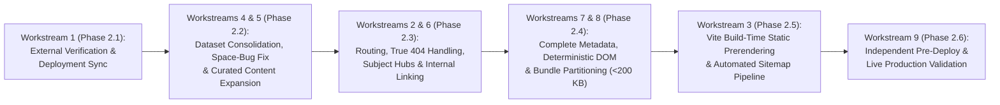

# Phase 2: SEO & Google Indexing Recovery Implementation Roadmap

**Target Property:** `https://study.freetoolshubs.com/`  
**Source Repository:** `d:/freetoolshubs/free-tools-study`  
**Scope:** Testable, dependency-ordered implementation roadmap across all 9 required workstreams.

> **Important Note on Technical Correctness vs. Google Indexing Outcomes:**  
> Completing the technical remediation phases below guarantees deterministic technical compliance (fast initial HTML payload, pre-rendered content and metadata, valid HTTP status codes, zero orphan pages, and high-value curated educational datasets). Actual Google Search crawling, indexing, and ranking timelines depend on Google's external scheduling and quality re-evaluation following sitemap resubmission.

---

## Roadmap Overview & Phase Dependency Graph

---

## Phase 2.1 — Production Access, GSC/Cloudflare Verification & Deployment Pipeline Alignment (Workstream 1)

### Objective
Verify external GSC/Cloudflare configurations, locate/align the production deployment repository, and eliminate configuration drift between root `netlify.toml` and `public/_headers` / `public/_redirects`.

### Files & Systems Affected
- Google Search Console (`https://study.freetoolshubs.com/` or `sc-domain:freetoolshubs.com`)
- Cloudflare Dashboard (Security Events, Bot Fight Mode, Caching)
- `public/_headers`
- `public/_redirects`
- `netlify.toml`
- `public/` static assets (`og-flashcards.png` / `icon-192.png` / `icon-512.png` / `index.html` favicon link)

### Dependencies
- Owner inputs from `PROJECT-OWNER-ACTION-REQUIRED.md`.

### Implementation Tasks
1. **Verify GSC Property & Cloudflare Bot Access:** Confirm the owner is inspecting the exact `https://study.freetoolshubs.com/` property and that Cloudflare is not challenging `AS15169` (Googlebot).
2. **Unify Headers in `public/_headers`:** Move security headers from `netlify.toml` into `public/_headers` (and update `Content-Security-Policy` to permit `https://static.cloudflareinsights.com` so Cloudflare Web Analytics is not blocked when headers take effect) so that deploying `dist/` to the separate deployment repository always carries the complete header configuration.
3. **Fix Missing Static Assets (`RC-10`):**
   - Remove the broken `<link rel="icon" type="image/svg+xml" href="/vite.svg" />` from `index.html` (line 6), keeping `/logo.svg`.
   - Point `og:image` in `Flashcards.tsx` (and `Quiz.tsx`) to `https://study.freetoolshubs.com/og-main.png` (or add a valid `public/og-flashcards.png` image).
   - Update `public/manifest.json` to reference existing `/logo.svg` or add valid `192x192` and `512x512` PNG icons.

### Risks & Rollback
- **Risk:** Overly strict `Content-Security-Policy` in `public/_headers` could block Google Tag Manager or Cloudflare scripts.
- **Rollback:** Revert `public/_headers` commit and redeploy `dist/`.

### Acceptance Criteria & Verification
- **Automated Test:** Asset verifier script confirms every `src`/`href`/`content` asset referenced in `index.html`, `manifest.json`, and `<Helmet>` exists in `public/` and `dist/`.
- **Production Check:** `curl -I` against all static asset URLs returns `HTTP 200` with `image/*` or `application/json` (never `text/html`).

---

## Phase 2.2 — Dataset Consolidation, Slug Normalization & Content Quality Remediation (Workstreams 4 & 5)

> **Phase 2A Status Update (Completed 2026-11-05):**  
> - `src/data/canonicalStudyTopics.json` (**65 canonical topics, 385,663 bytes / 385.66 KB**, down 98.98% from 37.81 MB) and `src/data/legacyTopicUrlManifest.json` (**5,000 dataset records / 10,000 URLs + 4 non-dataset nav slugs / 8 URLs**) have been generated via `scripts/buildCanonicalStudyData.js` and verified via `scripts/validateCanonicalStudyData.js` (`npm run validate:study-data`, exit code `0`).  
> - Legacy URL migration dispositions: **1,404 `redirect` records (2,808 URLs)** + **3 resolved nav slugs (6 URLs)**; **740 `manual_review` records (1,480 URLs)** + **1 unresolved nav slug (`/psychology-intro`, 2 URLs)**; **2,856 `obsolete` records (5,712 URLs)**.
>
> **Phase 2B Status Update (Completed 2026-11-05):**  
> - **Recovered 3 Orphaned Computer Science Topics:** Restored original authored content from `seedData.js` `realContentMap` for `computer-science-algorithms`, `computer-science-data-structures`, and `computer-science-machine-learning` (7 cards, 3 questions).
> - **Resolved 2 Editorial Quiz Defects:** Corrected `chemistry-organic-chemistry` branched isobutane IUPAC name (`2-methylpropane`) and `biology-evolution` human-directed artificial selection distinction.
> - **Expanded 21 Priority Canonical Topics:** All 21 priority topics now have 8–10 flashcards (198 total) and 5–6 quiz questions (116 total) with unique descriptions, learning objectives, and verification bases.
> - **Multi-Dimensional Quality Statuses:** Verified across 5 dimensions: **17 `verified`**, **4 `needs_review`** (documented review concepts for Macroeconomics, Microeconomics, Modernism, Social Psychology), and **44 `insufficient`** (placeholder fallback topics strictly excluded from indexability).
> - **Validated Gates:** Verified via `scripts/validateStudyContent.js` (`npm run validate:study-content`, exit code `0`) and `tsc --noEmit` (exit code `0`). Canonical dataset size: **650,440 bytes (650.44 KB)** (SHA-256: `7a7f50a54d7587eb`). Manifest URL coverage remains 100% complete and unchanged.
>
> **Phase 2C Status Update (Completed 2026-11-05):**  
> - **Canonical Data Access Layer (`src/services/studyDataService.ts`):** Centralized, strictly typed data-access layer implemented. Zero direct imports of `studyTopics.json` remain anywhere in `src/`.
> - **Soft-404 Elimination:** Removed `|| (studyData as any[])[0]` across all pages. Invalid or unknown topic requests render an explicit `<TopicNotFound />` component with `<meta name="robots" content="noindex, nofollow" />`.
> - **Client Bundle Protection:** 5.2 MB `legacyTopicUrlManifest.json` is 0% bundled into client code. Generated lightweight `src/data/legacySlugRedirectMap.json` (97 KB) for O(1) in-browser self-healing redirects.
> - **Lossless Progress Migration (`src/utils/progressMigration.ts`):** Implemented idempotent migration running on startup to remap legacy slug keys to canonical slugs and merge decks while preserving highest confidence and latest review timestamps.
> - **Bundle Optimization:** Total emitted client JS dropped from **30,030.85 kB (~30.03 MB)** to **1,004.65 kB (~1.00 MB)** (**96.65% reduction**). Emitted `study-data` chunk dropped from **29,677.21 kB (~29.68 MB)** to **634.46 kB** (**97.86% reduction**; gzip: 93.42 kB).
> - **Validated Gates:** Verified via `scripts/validateConsumerCutover.js` (`npm run validate:cutover`, exit code `0`), `scripts/validateStudyContent.js` (exit code `0`), `scripts/validateCanonicalStudyData.js` (exit code `0`), `tsc --noEmit` (exit code `0`), and production `vite build` (exit code `0`). Zero legacy data in client build.
>
> **Phase 2D Status Update (Completed 2026-11-05):**  
> - **Forensic URL Reconciliation:** Audited and reconciled all 10,008 source paths across manifest records and navigation URLs. Exactly 0 duplicate source paths and 0 conflicting mappings.
> - **Deterministic Netlify Redirect Generator (`scripts/generateNetlifyRedirects.js`):** Built-in generator outputs `public/_redirects` (8,657 lines, 527.66 KB).
> - **HTTP 301 Permanent Redirects:** Generated exactly **2,808 rules** (1,404 Flashcard + 1,404 Quiz) mapping genuine level variants to canonical destinations. 0 self-redirects, 0 loops, 0 chains.
> - **HTTP 410 Gone Responses:** Generated exactly **5,712 rules** (2,856 Flashcard + 2,856 Quiz) for confirmed permanently retired synthetic cycle repeats and invalid level pairings.
> - **Manual-Review Exclusions:** Verified 100% exclusion for all 1,482 manual-review URLs (0 automatic 301/410 rules generated).
> - **Soft-404 Elimination at Edge:** Replaced blanket `/* /index.html 200` with 136 explicit canonical 200 rewrite rules + deliberate `/* /404.html 404` final fallback. Removed blanket rewrite from `netlify.toml`.
> - **Static Error Pages:** Created standalone `public/404.html` and `public/410.html`.
> - **Validated Gates:** Verified via `scripts/validateNetlifyRedirects.js` (`npm run validate:redirects`, exit code `0`) across 10 validation gates and 15 simulated HTTP routing scenarios. Production build succeeds cleanly.

### Objective
Switch the application from the legacy 37.81 MB `src/data/studyTopics.json` to the validated 385.66 KB `src/data/canonicalStudyTopics.json` via a clean adapter/migration layer (Phase 2B), resolve the orphaned Computer Science seed content and editorial quiz issues, and enforce strict indexability gating based on `contentQuality.status`.

### Files & Systems Affected
- `scripts/seedData.js`
- `src/data/studyTopics.json` (and partitioned per-subject JSON files under `src/data/`)
- `src/utils/deterministicVariationEngine.ts`

### Dependencies
- Phase 2.1 complete.

### Implementation Tasks
1. **Fix Slug Generation Bug (`RC-04`):** Normalize both `sub.name` and `topic` using `.toLowerCase().replace(/[^a-z0-9]+/g, '-')` so `Computer Science` generates `computer-science-...` with zero spaces and properly binds to `realContentMap`.
2. **Consolidate to 65 Canonical Subtopic Slugs (`RC-06`):**
   - Replace the 5,000-record loop (`VARIATION_CYCLE = 500`) with **65 canonical subtopic records** (`1 per unique (subject, subTopic)` pair, e.g., `biology-cell-biology`, `chemistry-organic-chemistry`, `physics-mechanics`, `computer-science-algorithms`).
   - Notice this immediately makes the existing header/footer links (`/biology-cell-biology`, `/chemistry-organic-chemistry`, `/physics-mechanics`) valid canonical slugs!
   - Store applicable education levels (`High School`, `AP`, `College`, etc. — excluding nonsensical pairings like `MCAT Shakespeare` or `Kids Quantum Physics`) as an array `levels: string[]` on each canonical subtopic record rather than spawning 17 duplicate URLs per subtopic.
3. **Eliminate Placeholder Content & Expand Tier 1 Curated Decks:**
   - Remove `generateFallbackContent`'s bogus quiz options (`"Common student misconception"`, `"Related but incorrect concept"`, `"Irrelevant distractor"`) and intra-deck card repetition.
   - Expand the **21 Tier 1 subtopics** (the 18 currently matched `realContentMap` topics + 3 Computer Science topics: `Algorithms`, `Data Structures`, `Machine Learning`) so each has **≥ 15 distinct, accurate flashcards** and **≥ 10 distinct multiple-choice quiz questions** with real academic distractors and explanations.
   - Mark each record with an explicit boolean `isIndexable: true | false` field (`true` for the 21 fully curated Tier 1 subtopics; `false` for any Tier 2 subtopic until its curated deck reaches the ≥15 cards / ≥10 questions threshold).
4. **Remove Misleading Claims (`deterministicVariationEngine.ts`, `Home.tsx`, `Flashcards.tsx`):**
   - Replace fabricated student testimonials/certification counts in `deterministicVariationEngine.ts` with factual, topic-specific study guidance and learning objectives.

### Risks & Rollback
- **Risk:** Users with existing saved decks in `localStorage`/`IndexedDB` keyed by an old slug (`biology-cell-biology-high-school`) could lose access if not mapped.
- **Mitigation & Rollback:** Add a lightweight slug-normalization helper that maps legacy `*-{level}-v{N}` slugs to their canonical `subject-subtopic` slug in both client routing and `_redirects`.

### Acceptance Criteria & Verification
- **Automated Dataset Test:**
  - `0` slugs contain spaces or uppercase characters.
  - `0` records contain `"Common student misconception"` or `"Irrelevant distractor"`.
  - `0` records repeat the same flashcard question or quiz question within a deck.
  - Every record with `isIndexable: true` has `≥ 15` unique flashcards and `≥ 10` unique quiz questions.
  - Total dataset size across all files is **< 500 KB** (down from 37.81 MB).

---

## Phase 2.3 — Routing, Soft-404 Elimination, Subject Hubs & Internal Link Architecture (Workstreams 2 & 6)

### Objective
Eliminate the `|| studyData[0]` soft-404 bug, ensure invalid URLs render `<NotFound />` (and return HTTP 404 in production), fix all broken navigation links, and introduce Subject Directory Hub pages (`/subjects/:subject`) so 100% of indexable pages are reachable within ≤ 2 clicks from `/`.

### Files & Systems Affected
- `src/App.tsx`
- `src/layouts/MainLayout.tsx`
- `src/pages/Home.tsx`
- `src/pages/Flashcards.tsx`
- `src/pages/Quiz.tsx`
- `src/pages/Planner.tsx`
- `src/pages/SubjectHub.tsx` *(new component)*
- `public/_redirects`

### Dependencies
- Phase 2.2 (canonical subtopic slugs and `isIndexable` classification).

### Implementation Tasks
1. **Eliminate Soft-404 Fallback (`RC-05`):**
   - In `Flashcards.tsx` and `Quiz.tsx`, remove `|| (studyData as any[])[0]`.
   - If `slug` is not found in the canonical dataset:
     - Check if `slug` matches a legacy level/version slug (`^{canonicalSlug}-({levelSlug})(-v\d+)?$`); if so, `<Navigate to={`/${canonicalSlug}`} replace />` (complemented by server-side `301` redirects in `_redirects`).
     - Otherwise, render `<NotFound />` directly (which sets `<meta name="robots" content="noindex" />`).
2. **Build Subject Directory Pages (`/subjects/:subjectSlug`) (`RC-03`):**
   - Add route `<Route path="/subjects/:subjectSlug" element={<SubjectHub />} />` in `App.tsx`.
   - Each of the 9 Subject Hub pages (`/subjects/biology`, `/subjects/chemistry`, `/subjects/physics`, `/subjects/math`, `/subjects/history`, `/subjects/computer-science`, `/subjects/psychology`, `/subjects/economics`, `/subjects/literature`) lists all subtopics in that subject with direct `<Link>` anchors to both the Flashcard deck (`/:slug`) and Practice Quiz (`/quiz/:slug`).
3. **Fix All Navigation & Category Links (`MainLayout.tsx`, `Home.tsx`, `Quiz.tsx`):**
   - Update `MainLayout.tsx` footer "Popular Subjects" links to point to valid canonical routes (`/subjects/biology`, `/subjects/chemistry`, `/subjects/physics`, `/subjects/psychology` or `/psychology-cognitive-psychology`).
   - Update `Home.tsx` "Browse Popular Categories" pills to link to the 9 Subject Hub pages (`/subjects/:subjectSlug`) AND add a "Featured Study Decks & Quizzes" grid linking directly to the 21 Tier 1 canonical subtopics.
   - Update `Flashcards.tsx` and `Quiz.tsx` to include visible HTML Breadcrumbs (`Home` → `{Subject}` → `{SubTopic}`), a permanent header link between the Flashcard deck (`/:slug`) and Quiz (`/quiz/:slug`), and a "Related {Subject} Topics" section at the bottom of the page linking to sibling subtopics in the same subject.

### Risks & Rollback
- **Risk:** Route collision between `/:subject` (flashcard topic slug) and static routes.
- **Mitigation:** React Router v7 ranks static segments (`/subjects/:subjectSlug`, `/quiz/:subject`, `/about`, `/contact`, etc.) above dynamic `:subject`, and explicit slug lookup validates `/:subject` against known topic slugs.

### Acceptance Criteria & Verification
- **Automated Link-Graph Test:** BFS crawler starting from `/` reaches 100% of indexable routes (Static + 9 Subject Hubs + all Tier 1 Flashcard & Quiz URLs) at Crawl Depth ≤ 2 with `0` broken links and `0` orphan pages.
- **Browser Test:** Navigating to `/nonexistent-flashcard-slug-xyz-999` or `/quiz/nonexistent-quiz-slug-xyz-999` renders the `404 Topic Not Found` UI (`<NotFound />`) with `<meta name="robots" content="noindex" />` and never displays Cell Biology.

---

## Phase 2.4 — Complete Technical SEO Metadata, Deterministic Crawlable DOM & Performance Optimization (Workstreams 7 & 8)

### Objective
Ensure every route has complete, accurate metadata and canonical tags, make all flashcard and quiz educational content visible in the initial deterministic DOM without requiring clicks, and reduce the initial JS bundle from 30.00 MB to < 200 KB.

### Files & Systems Affected
- `src/pages/Home.tsx`
- `src/pages/Planner.tsx`
- `src/pages/About.tsx`
- `src/pages/Contact.tsx`
- `src/pages/Flashcards.tsx`
- `src/pages/Quiz.tsx`
- `src/modules/studyEngine.ts`
- `src/App.tsx`
- `vite.config.ts`

### Dependencies
- Phase 2.2 & Phase 2.3.

### Implementation Tasks
1. **Add Complete `<Helmet>` Metadata & Canonicals Across All Pages (`RC-09`):**
   - Add `<Helmet>` with unique `<title>`, `<meta name="description">`, `<link rel="canonical" href="https://study.freetoolshubs.com/..." />`, and OpenGraph tags to `Home.tsx` (`/`), `Planner.tsx` (`/study-timetable-template`), `About.tsx` (`/about`), `Contact.tsx` (`/contact`), and `SubjectHub.tsx` (`/subjects/:subjectSlug`).
   - On `Flashcards.tsx` and `Quiz.tsx`, always compute `<link rel="canonical">` from `topicData.slug` (never raw unvalidated `useParams().subject`), and if `!topicData.isIndexable` (Tier 2 topics awaiting content expansion), output `<meta name="robots" content="noindex, follow" />`.
   - Fix `Quiz.tsx` `BreadcrumbList` JSON-LD so Position 2 points to the Subject Hub (`https://study.freetoolshubs.com/subjects/${subjectSlug}`) instead of the broken `/quiz/biology-cell-biology` URL.
2. **Render Deterministic, Complete Study Content in the Initial DOM (`RC-07`):**
   - In `src/modules/studyEngine.ts`, remove `.sort(() => Math.random() - 0.5)` from initial deck/quiz initialization so initial page renders are 100% deterministic (add an optional `shuffle = false` parameter triggered only when the user clicks a "Shuffle" button).
   - In `Flashcards.tsx`, keep the interactive single-card flip widget at the top, and render a semantic **"All Flashcards in This Deck ({currentDeck.length} Cards)"** reference list below the controls so all questions and answers exist in the initial DOM.
   - In `Quiz.tsx`, keep the interactive quiz widget at the top, and render a **"Key Concepts & Study Summary"** section + permanent link to the Flashcard deck below the quiz widget so initial DOM has substantial, unique educational content before quiz completion.
3. **Code Splitting & Bundle Optimization (`RC-01`):**
   - Convert route imports in `src/App.tsx` to `React.lazy()` wrapped in `<Suspense>` (while keeping static prerender entry able to render synchronously).
   - Separate lightweight catalog metadata (`slug`, `subject`, `subTopic`, `description`, `isIndexable`) from full flashcard/quiz arrays so `Home.tsx` and `MainLayout.tsx` never import the full question/answer arrays.

### Risks & Rollback
- **Risk:** Lazy loading routes without updating offline storage could affect offline navigation if chunks aren't cached.
- **Mitigation:** Because the consolidated dataset is < 250 KB total (down from 37.81 MB), even keeping the curated Tier 1 dataset in a single shared chunk is only ~60 KB gzipped!

### Acceptance Criteria & Verification
- **Bundle Size Gate:** `npm run build` produces total JS + CSS assets < 500 KB uncompressed (< 150 KB gzipped), down from 30.03 MB.
- **DOM Content Gate:** Initial render of `/:slug` contains all ≥15 flashcard Q&A pairs in deterministic order.

---

## Phase 2E — Static HTML Prerendering, Canonical SEO & Sitemap Generation (COMPLETED)

### Objective
Eliminate the client-only SPA discoverability bottleneck by pre-rendering eligible educational pages into crawlable static HTML, establishing canonical topic URL policies, embedding complete structured metadata (Schema.org JSON-LD), and generating a strict, 23-URL production sitemap.

### Deliverables & Implementation Status
1. **Static HTML Prerendering Engine (`scripts/prerenderStaticPages.js`):** **COMPLETED**.
   - Built-time SSR engine compiles `src/entry-server.tsx` using Vite SSR.
   - Pre-renders all 136 routes (1 root, 5 static, 65 canonical flashcard topics, 65 quiz routes) in 1.61s.
   - Total HTML output: 3.09 MB.
   - Emits Netlify-compatible file structure (`dist/${route}/index.html` and `dist/${route}.html`).
2. **Deterministic Sitemap Generator (`scripts/generateSitemap.js`):** **COMPLETED**.
   - Produces `public/sitemap.xml` and `dist/sitemap.xml` containing exactly 23 approved canonical URLs.
   - 0 redirecting URLs, 0 obsolete URLs, 0 noindex URLs, 0 quiz URLs, 0 unverified topics.
3. **Robots Directives & Indexing Gate:** **COMPLETED**.
   - Exactly 17 verified topics carry `<meta name="robots" content="index, follow" />`.
   - All 4 `needs_review` and 44 `insufficient` topics carry `<meta name="robots" content="noindex, follow" />`.
   - All 65 quiz routes carry `<meta name="robots" content="noindex, follow" />` and canonicalize to primary topic (`/${slug}`).
4. **Structured Data (Schema.org JSON-LD):** **COMPLETED**.
   - Valid `WebSite` schema on homepage.
   - Valid `BreadcrumbList`, `LearningResource`, and `FAQPage` schemas on verified topics.
   - 0 fabricated review ratings, 0 fake star counts, 0 artificial author personas.
5. **Automated Validation Suite (`scripts/validatePrerenderedSEO.js`):** **COMPLETED**.
   - 28 / 28 automated quality gates passing with Exit Code 0.
   - Full documentation recorded in `docs/seo/indexing-recovery/PHASE-2E-*.md`.

---

## Phase 2F — Build Verification, Deployment Packaging & Production Rollout (NEXT PHASE)

### Objective
Independently verify source build artifacts, local preview HTTP responses, and prepare deployment packaging for the separate production deployment repository.

### Release Gates & Prerequisites
- Full production build sequence (`npm run build`) passing deterministically.
- All 80 automated quality gates passing across Phases 2A, 2B, 2C, 2D, and 2E.
- Prepare production deployment branch / artifacts for zero-downtime deployment.

### Validation Checklist & Release Gates

| Gate # | Check | Verification Command / Method | Pass Criterion |
|---:|---|---|---|
| **G-1** | TypeScript & Vite Build + Prerender | `npm run build` | Exits `0`; generates `dist/sitemap.xml`, `dist/404.html`, and pre-rendered `index.html` for every route. |
| **G-2** | Bundle Size Verification | Inspect `dist/assets/*` | Total JS + CSS in `dist/assets/` is **< 500 KB** uncompressed (no 29.68 MB `study-data` file). |
| **G-3** | Pre-JS HTML Verification | Parse all `dist/**/index.html` files via Python validator | Every indexable page has exactly 1 `<title>`, 1 `<meta name="description">`, 1 self-referencing `<link rel="canonical">`, 1 `<h1>`, and ≥10 internal `<a href>` links. |
| **G-4** | Sitemap vs. HTML Reconciliation | Run `audit.py` on `dist/sitemap.xml` | 0 URLs with spaces; 0 `noindex` pages in sitemap; 100% of sitemap URLs exist in `dist/` and have matching canonical tags. |
| **G-5** | HTTP Status & Soft-404 Check | Probe live production with `probe_prod.py` after deploy | Valid routes return `200 OK` with pre-rendered HTML; `/nonexistent-flashcard-slug-xyz-999` and `/quiz/nonexistent-quiz-slug-xyz-999` return **`404 Not Found`**. |
| **G-6** | Interactive SPA Hydration & Offline Check | Browser test on `/`, `/biology-cell-biology`, `/quiz/biology-cell-biology`, `/study-timetable-template` | Card flipping, confidence scoring, quiz scoring, streak counter, and drag-and-drop planner persist across reloads in `localStorage`/`IndexedDB` with 0 console errors. |
| **G-7** | GSC Live URL Inspection & Sitemap Resubmission | Owner runs URL Inspection Live Test on `/`, `/subjects/biology`, and `/biology-cell-biology`, then resubmits `https://study.freetoolshubs.com/sitemap.xml` | GSC shows `URL is available to Google`, `Page fetch: Successful`, `Indexing allowed: Yes`, and `Sitemap status: Success`. |

