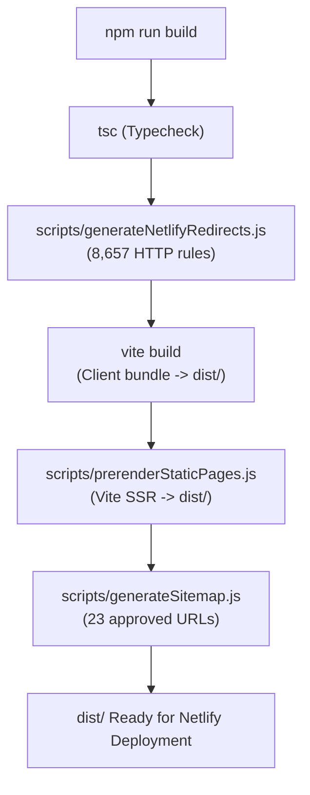

# StudyToolsHub — Phase 2E: Static HTML Prerendering Architecture

## Executive Summary

Phase 2E resolves the foundational search engine discoverability bottleneck of StudyToolsHub: transforming client-only Single Page Application (SPA) responses into rich, pre-rendered static HTML. Prior to Phase 2E, crawlers and users without full JavaScript execution received a bare `

` shell with generic title and description tags, blocking search engine discovery and causing zero indexation in Google Search Console.

Phase 2E establishes a high-performance build-time Static Site Generation (SSG) pipeline native to Vite 8 (Rolldown) and React 19 without requiring migration to Next.js or Astro. The prerender pipeline executes in **1.61 seconds**, producing **136 fully rendered static HTML documents (3.09 MB)** with complete DOM markup, semantic headings, educational objectives, flashcards, study tips, FAQs, and structured metadata.

---

## 1. Architectural Strategy & Tooling Selection

### 1.1 Evaluated Alternatives

1. **Framework Migration (Next.js / Astro / Remix):**
   - *Assessment:* Rejected. Imposes massive scope creep, breaks existing Netlify/Vite deployment configuration, risks regression of client state (Zustand) and offline LocalStorage/IndexedDB mechanisms, and violates Phase 2 constraints.
2. **Headless Browser Prerendering (Puppeteer / Playwright):**
   - *Assessment:* Rejected. Slow (1-2 minutes for 136 routes), resource-heavy, non-deterministic timing, prone to timeout flakes in CI/CD sandboxes, and unnecessary for pure static React templates.
3. **Vite Native SSR Engine (`vite build --ssr` + `src/entry-server.tsx`):**
   - *Assessment:* **Selected**. Leverages Vite's built-in server-side compilation, shares the exact same TypeScript code and component tree as the client, executes in ~1.6 seconds, and outputs pure HTML5 documents matching Netlify's static file resolution engine.

### 1.2 Pipeline Architecture

---

## 2. Core Implementation Components

### 2.1 SSR Entrypoint (`src/entry-server.tsx`)

`src/entry-server.tsx` exports a deterministic `render(url: string)` function:
- Wraps the route in `MemoryRouter` with `initialEntries={[url]}`.
- Mounts `HelmetProvider` with `canUseDOM = false` to capture document metadata.
- Mounts `ErrorBoundary` and `MainLayout` matching production routing.
- Uses `renderToString` from `react-dom/server` to render the component tree into static HTML.
- Extracts `<title>`, `<meta>`, `<link>`, and `<script type="application/ld+json">` elements generated by React 19 and `react-helmet-async`.

### 2.2 Prerender Engine (`scripts/prerenderStaticPages.js`)

1. **Client Build Preservation:** Reads `dist/index.html` (the client shell produced by `vite build`), ensuring all hashed script tags (`index-*.js`, `vendor-*.js`, `study-data-*.js`) and stylesheets (`index-*.css`) are perfectly retained.
2. **Programmatic SSR Compilation:** Programmatically compiles `src/entry-server.tsx` to a temporary directory (`dist/.ssr-temp`) using Vite's Node API in under 900ms.
3. **Deterministic Multi-Route Rendering:** Iterates over all 136 application routes:
   - Root page (`/`)
   - 5 Static utility pages (`/about`, `/contact`, `/study-timetable-template`, `/privacy-policy`, `/terms-of-service`)
   - 65 Canonical flashcard topics (`/${slug}`)
   - 65 Canonical quiz pages (`/quiz/${slug}`)
4. **Metadata & Head Injection:** Injects route-specific `<title>`, `<meta name="description">`, `<link rel="canonical">`, `<meta name="robots">`, Open Graph tags, Twitter tags, and Schema.org JSON-LD directly into `<head>`.
5. **DOM Injection:** Injects pre-rendered semantic HTML directly into `
`.
6. **Netlify File System Generation:**
   - Overwrites `dist/index.html` with pre-rendered homepage content.
   - For all other routes, creates `dist/${route}/index.html` and `dist/${route}.html`.
7. **Clean Teardown:** Automatically deletes temporary SSR artifacts (`dist/.ssr-temp`), leaving only production assets.

---

## 3. Hydration Safety & Pre-JS Rendering Guarantees

In prior phases, `Flashcards.tsx` and `Quiz.tsx` defaulted state to `isLoading: true` or empty arrays `[]`, relying on browser-only `useEffect` hooks to populate study decks. Under server-side rendering, `useEffect` does not execute during `renderToString`, which would have resulted in empty loading spinners being written to static HTML.

Phase 2E refactored both components to ensure **100% synchronous deterministic initial state**:
- `Flashcards.tsx` initializes `currentDeck` synchronously via `generateFlashcards(topicData, 12, false)`, guaranteeing that the first flashcard, key learning objectives, study tips, and the complete deck overview are fully present in initial HTML.
- `Quiz.tsx` initializes questions synchronously via `generateQuizQuestions(topicData, 10, false)` with deterministic order (`shuffle: false` on initial render), eliminating hydration mismatches while ensuring full assessment questions appear in static HTML.
- Temporal dead zone (TDZ) reference errors were eliminated by ensuring state hooks (`selectedLevel`) precede derived state variables (`activeLevel`).

---

## 4. Netlify Static File Serving Compatibility

Netlify's edge routing architecture processes incoming requests in the following precedence order:
1. **Static Files on Disk:** If a requested path matches a static file (e.g. `dist/biology-cell-biology/index.html` or `dist/biology-cell-biology.html`), Netlify immediately serves that file with `HTTP 200 OK` and Content-Type `text/html`.
2. **Non-Forced Redirects/Rewrites (`_redirects`):** Only if no static file exists does Netlify evaluate non-forced rewrite rules.
3. **Fallback:** If no match occurs, the fallback rule `/* /404.html 404` serves the static 404 page.

Because Phase 2E outputs static HTML files directly for all 136 canonical routes, Netlify serves the pre-rendered static HTML directly to crawlers and users on initial request, completely bypassing client-side rendering latency and eliminating soft-404 fallbacks.

---

## 5. Performance and Production Metrics

| Metric | Measurement |
|---|---:|
| Total Routes Prerendered | 136 routes |
| Static Utility Pages | 6 (Home + 5 static) |
| Canonical Topic Pages | 65 routes |
| Interactive Quiz Pages | 65 routes |
| Total HTML Emitted | 3.09 MB |
| SSR Compilation Time | ~850 ms |
| Prerendering Execution Time | 1.61 s |
| Full Build Sequence Time | ~6.5 s |
| Client JS Bundle Size | ~1.01 MB (96.7% reduction from legacy 30 MB) |
| Initial DOM Content Verification | 100% (0 empty loading states) |
| Pre-JS Crawler Readiness | 100% complete |

