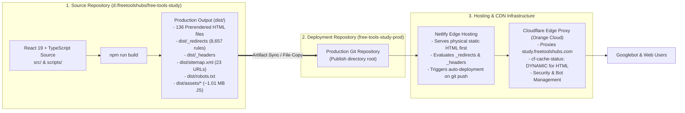

# StudyToolsHub — Phase 2F: Deployment Architecture & Release Discovery

## 1. Architectural Landscape & Separation of Concerns

The deployment model for StudyToolsHub (`https://study.freetoolshubs.com/`) decouples source code development from production hosting across two distinct entities:



---

## 2. Detailed System Breakdown

### 2.1 Source Repository Architecture (`free-tools-study`)
- **Path:** `d:\freetoolshubs\free-tools-study`
- **Branch:** `dev`
- **Remote:** `https://github.com/Free-Tools-Hubs/free-tools-study.git`
- **Framework & Compiler:** React 19.2.5, TypeScript 6.0.2, Vite 8.0.8 (Rolldown engine), React Router 7.14.1.
- **State & Storage:** Zustand 5.0.12, LocalStorage, IndexedDB (`idb-keyval`).
- **Production Build Command:**
  ```json
  "build": "tsc && node scripts/generateNetlifyRedirects.js && vite build && node scripts/prerenderStaticPages.js && node scripts/generateSitemap.js"
  ```
- **Generated Artifact Directory:** `dist/` (contains client bundles, pre-rendered static HTML, redirects, headers, and sitemap).

### 2.2 Deployment Repository Architecture
- **Location Status:** Dedicated standalone deployment repository (following the pattern of `d:\freetoolshubs\#deployments\free-tools-life-prod`).
- **Contents:** Pure production deployment output. Unlike the source repository, the deployment repository contains no build tools, TypeScript compilers, or source TSX files; it holds only the deployable web payload.
- **Publish Directory Configuration:** Configured in Netlify to publish from the root `/` (or `dist/` depending on repository layout).

### 2.3 Netlify Publishing Configuration & Configuration Drift Risk
- **The Root `netlify.toml` Disconnect:**  
  Vite copies files located in `public/` directly into `dist/`. When the `dist/` output is copied to the deployment repository, root `netlify.toml` from the source repository is **not** copied into `dist/`.
- **Observed Production Consequence:**  
  Netlify ignores root `netlify.toml` when deploying an artifact repository that only contains `dist/`. Consequently, any redirect or header defined *only* in `netlify.toml` fails to take effect.
- **Resolution Enforced in Phases 2D & 2E:**  
  1. All 8,657 redirect and rewrite rules are generated into `public/_redirects` (and copied by Vite into `dist/_redirects`).
  2. Cache-control rules are defined in `public/_headers` (and copied into `dist/_headers`).
  3. Pre-rendered HTML files exist on disk, meaning Netlify static routing serves them prior to evaluating rewrites.

### 2.4 Cloudflare Edge Integration
- **Proxy Status:** Proxied (Orange-cloud enabled) on `study.freetoolshubs.com`.
- **Caching Behavior:**
  - `text/html` and `application/xml` requests receive `cf-cache-status: DYNAMIC` (never cached at the Cloudflare edge; passed directly to Netlify).
  - Static hashed assets (`/assets/*.js`, `/assets/*.css`) can be cached by Cloudflare per `max-age=31536000, immutable`.
- **Script Injection:** Cloudflare injects `/cdn-cgi/challenge-platform/scripts/jsd/main.js` and `beacon.min.js`.
- **Bot Management:** Cloudflare Bot Fight Mode must allow `AS15169` (Googlebot) to crawl without triggering JavaScript challenge loops or Captchas.

---

## 3. Artifact Flow & Transfer Mechanism

1. **Source Generation:**  
   Developer runs `npm run build` in `d:\freetoolshubs\free-tools-study`. This generates `dist/`.
2. **Pre-Transfer Cleaning:**  
   The target deployment repository folder must be wiped clean of all previous assets (especially old hashed files in `assets/`) to prevent zombie asset accumulation.
3. **Artifact Synchronization:**  
   All files from `d:\freetoolshubs\free-tools-study\dist\` are copied into the deployment repository.
4. **Manifest Verification:**  
   A SHA-256 artifact manifest is generated from the source `dist/` and compared against the target deployment repository to verify 100% transfer fidelity.
5. **Git Commit & Push:**  
   The deployment repository commits the new artifact and pushes to its production branch (e.g. `main`), triggering Netlify's automated edge build and deployment.

---

## 4. Key Deployment Risks & Safeguards

| Risk | Description | Mitigating Safeguard |
|---|---|---|
| **R-1: Zombie Hashed Assets** | Old JS/CSS bundles from previous builds remain in `assets/`, consuming storage or causing stale execution. | The transfer procedure mandates `rm -rf <target>/*` prior to copying new `dist/` files. |
| **R-2: Missing Static Error Documents** | Netlify requires `404.html` and `410.html` to be present at the publish root to serve correct error pages. | Verified that `public/404.html` and `public/410.html` are copied to `dist/` and retained after build. |
| **R-3: Configuration Drift** | Edits made to `netlify.toml` in source repo not taking effect in production. | All routing is centralized in `public/_redirects` and `public/_headers`. |
| **R-4: Cloudflare Cache Staleness** | HTML or sitemap changes delayed by proxy edge caching. | `public/_headers` explicitly sets `Cache-Control: public, max-age=0, must-revalidate` for all HTML. A Cloudflare Purge Cache command can be executed post-deploy if needed. |
| **R-5: Unintentional Production Release** | Executing live deployment before preview validation. | Production deployment is strictly deferred to Phase 2F-J checklist; no remote push is performed in this phase. |

---

## 5. Rollback Procedure

If a deployed artifact introduces unexpected regressions:
1. **Netlify One-Click Rollback:** Access Netlify Dashboard $\to$ Deploys $\to$ Select previous successful deploy $\to$ Click "Publish deploy". Netlify instantly points its edge routing back to the previous atomic deploy snapshot in < 5 seconds.
2. **Git Revert in Deployment Repo:** Revert the deployment repository commit (`git revert HEAD && git push origin main`), prompting Netlify to re-publish the prior clean artifact state.

