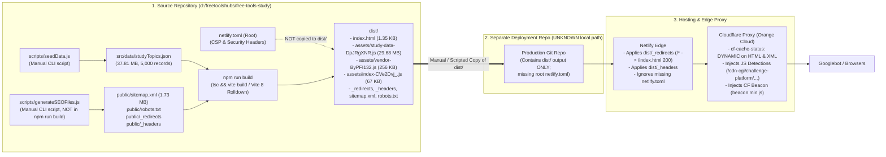

# Rendering & Deployment Architecture Audit

**Target Property:** `https://study.freetoolshubs.com/`  
**Source Repository:** `d:/freetoolshubs/free-tools-study`  
**Evidence Classification:** `VERIFIED_SOURCE`, `VERIFIED_PRODUCTION`, `UNKNOWN` (where external deployment repo is referenced).

---

## 1. Current Production Deployment Architecture

### 1.1 End-to-End Architecture Diagram (`VERIFIED_SOURCE` + `VERIFIED_PRODUCTION`)



### 1.2 Points Where Stale or Incorrect Artifacts Enter the Pipeline

| Failure Point | Mechanism (`VERIFIED_SOURCE` / `VERIFIED_PRODUCTION`) | Observed Production Consequence |
|---|---|---|
| **FP-1: Unlinked SEO Script** | `package.json` defines `"build": "tsc && vite build"` and `"generate-seo": "node scripts/generateSEOFiles.js"` separately. Running `npm run build` does **not** regenerate `public/sitemap.xml` or `public/robots.txt`. | If `studyTopics.json` or routes change without manually running `npm run generate-seo` prior to `npm run build`, `dist/sitemap.xml` becomes immediately stale. |
| **FP-2: Root `netlify.toml` Excluded from `dist/`** | Vite only copies `public/*` into `dist/`. When `dist/` is copied to the separate production deployment repository, root `netlify.toml` is left behind. | Confirmed via live HTTP headers (`VERIFIED_PRODUCTION`): `X-Frame-Options`, `X-Content-Type-Options`, `X-XSS-Protection`, `Referrer-Policy`, and `Content-Security-Policy` defined in `netlify.toml` are **completely absent** on `https://study.freetoolshubs.com/`, whereas `public/_headers` and `public/_redirects` are active. |
| **FP-3: Conflicting / Duplicated Routing & Header Config** | Both `netlify.toml` and `public/_redirects` define `/* /index.html 200`. Both `netlify.toml` and `public/_headers` define `/assets/*` cache headers, while `public/_headers` adds `/* Cache-Control: public, max-age=0, must-revalidate`. | Developers editing `netlify.toml` believe they are updating production routing/headers, when production actually only reads `public/_redirects` and `public/_headers`. |
| **FP-4: Separate Deployment Repository Sync** | The production deployment repository is separate from `d:/freetoolshubs/free-tools-study` and is not present in `d:/freetoolshubs/#deployments` (which only holds `free-tools-life-prod` and `free-tools-prod`). | If old hashed bundles or removed static files are not cleaned (`rm -rf dist/*`) in the deployment repository before copying new build output, stale files remain publicly accessible on Netlify. |
| **FP-5: Cloudflare HTML Rewriting & Bot Filtering** | Cloudflare intercepts all `text/html` responses (`cf-cache-status: DYNAMIC`) and injects `/cdn-cgi/challenge-platform/scripts/jsd/main.js` (JS Detections iframe) and `beacon.min.js`. | While anonymous `urllib` requests received `200 OK`, Cloudflare Bot Fight Mode or WAF rules can challenge/block crawlers, and if `netlify.toml`'s strict `Content-Security-Policy` were ever enabled, it would block Cloudflare's injected scripts. |

---

## 2. Current Rendering Architecture & Limitations (`VERIFIED_SOURCE` + `VERIFIED_PRODUCTION`)

### 2.1 Original HTML vs. Client-Rendered DOM Comparison

#### Initial Server Response (`index.html` — Identical Across All 10,005+ URLs)
Every URL on `https://study.freetoolshubs.com/` (including `/`, `/biology-cell-biology-high-school`, `/quiz/biology-cell-biology-high-school`, `/study-timetable-template`, `/about`, and `/nonexistent-flashcard-slug-xyz-999`) returns the exact same 3,130-byte HTML document:

```html
<head>
  ...
  <title>StudyToolsHub - Premium Free Student Study Tools</title>
  <meta name="description"
    content="Instant flashcards, adaptive quizzes, and smart study planners. 100% free, 100% offline, designed for student success." />
  ...
  <script type="module" crossorigin src="/assets/index-CVe2Dvj_.js"></script>
  <link rel="modulepreload" crossorigin href="/assets/rolldown-runtime-DF2fYuay.js">
  <link rel="modulepreload" crossorigin href="/assets/vendor-ByPFI132.js">
  <link rel="modulepreload" crossorigin href="/assets/study-data-DpJRgXNR.js">
  <link rel="stylesheet" crossorigin href="/assets/index--uzkF-ef.css">
</head>
<body>
  <div id="root"></div>
  <!-- Cloudflare injected scripts -->
</body>
```

#### Route-by-Route Comparison: Original HTML vs. Rendered DOM

| Route | Element | Original HTML (Pre-JS) | Rendered DOM (Post-JS, After 29.68 MB Download) | Critical Defect |
|---|---|---|---|---|
| **Homepage (`/`)** | `<title>` | `StudyToolsHub - Premium Free Student Study Tools` | `StudyToolsHub - Premium Free Student Study Tools` *(or stale `<title>` from previous SPA route!)* | `Home.tsx` has **no `<Helmet>`**. Navigating from `/about` to `/` leaves `<title>About Us - StudyToolsHub</title>` on `/`! |
| **Homepage (`/`)** | `<link rel="canonical">` | **None** | **None** *(or stale `<link rel="canonical">` from previous SPA route!)* | `index.html` and `Home.tsx` never declare a canonical tag for `/`. |
| **Homepage (`/`)** | Main Content & Links | Empty `<div id="root"></div>` (0 links) | Hero section + 3 feature cards + 9 category links (1 broken with space: `/computer science-data-structures-graduate`; 4 header/footer links point to nonexistent slugs). | Zero links or content in initial HTML; broken internal links in rendered DOM. |
| **Flashcards (`/:subject`)** | `<title>` & `<meta description>` | Generic homepage title & description | `{subTopic} Flashcards - {level} Study Tools` & `topicData.description` | Only visible after downloading & parsing 29.68 MB `study-data-DpJRgXNR.js`. |
| **Flashcards (`/:subject`)** | `<link rel="canonical">` | **None** | `https://study.freetoolshubs.com/${subject}` | On invalid slugs (e.g., `/chemistry-organic-chemistry`), renders Cell Biology but sets canonical to the invalid URL! |
| **Flashcards (`/:subject`)** | Study Content (`<h1>`, Cards) | Empty `<div id="root"></div>` | `<h1>{subTopic} Flashcards</h1>`, intro, 1 study tip, 1 testimonial, 3 boilerplate FAQs, and **ONLY 1 FLASHCARD (`currentDeck[0]`)** chosen via `Math.random() - 0.5`. | Cards `2..N` are never rendered in the DOM unless clicked; `currentDeck[0]` mutates randomly across visits. |
| **Quiz (`/quiz/:subject`)** | `<title>`, `<link rel="canonical">` | Generic homepage title; **no canonical** | `{subTopic} Quiz - {level} Practice Questions`; canonical `https://study.freetoolshubs.com/quiz/${subject}` | Same soft-404 canonical defect on invalid slugs (`/quiz/biology-cell-biology`). |
| **Quiz (`/quiz/:subject`)** | Study Content & Internal Links | Empty `<div id="root"></div>` | `<h1>{subTopic} Practice Questions</h1>`, **ONLY 1 QUESTION (`questions[0]`)**, 4 options, **0 answers, 0 explanations**, and **0 internal links** inside `<Quiz />` (the link back to `/${slug}` only renders after completing all questions!). | Explanations (`q.explanation`) and questions `2..N` are completely invisible to search engines; `questions[0]` is randomized via `Math.random() - 0.5`. |
| **Planner (`/study-timetable-template`, `/planner/:examType`)** | Metadata & Canonical | Generic homepage title; **no canonical** | Generic homepage title *(or stale title/canonical from prior SPA route)* | `Planner.tsx` has **no `<Helmet>` component at all**. |
| **Static Pages (`/about`, `/contact`)** | `<link rel="canonical">` | **None** | **None** | `About.tsx` and `Contact.tsx` set `<title>` and `<meta name="description">` in `<Helmet>`, but omit `<link rel="canonical">`. |

---

## 3. Why Current Client-Side Rendering Fails Googlebot WRS

1. **The 29.68 MB Static Import Bottleneck (`VERIFIED_PRODUCTION`):**
   - In `vite.config.ts`, splitting `studyTopics.json` into a `manualChunks` chunk named `study-data` **did not make it lazy-loaded**.
   - Because `App.tsx` statically imports `Home`, `Flashcards`, `Quiz`, and `Planner` at the top level, Rollup/Rolldown emits `import{t as z}from"./study-data-DpJRgXNR.js"` at byte 0 of the entry script `index-CVe2Dvj_.js` and injects `<link rel="modulepreload" crossorigin href="/assets/study-data-DpJRgXNR.js">` into `index.html`.
   - According to the ECMAScript module specification, an ES module graph cannot execute any module body until all of its static dependencies have been fetched, parsed, and instantiated.
   - Therefore, Googlebot's Web Rendering Service (WRS) must download and parse **29.68 MB of JavaScript** just to render `/about` or `/biology-cell-biology-high-school`. Under Google's crawl budget and WRS memory/CPU limits, a 30 MB synchronous JS graph frequently aborts, times out, or leaves the page in the pre-rendered `<div id="root"></div>` state.
2. **Client-Side `react-helmet-async` Mutation Delay:**
   - Because `Helmet` only mutates `<head>` after React mounts, any failure or delay in fetching `study-data-DpJRgXNR.js` leaves every URL with the homepage `<title>` and no canonical tag.
3. **Interactive State Gating (`currentIndex = 0`):**
   - Googlebot WRS does not click "Next Card" 12 times or select quiz options 10 times to reach the quiz review screen. Even when WRS succeeds, 80%–90% of the educational content in `topicData.baseFlashcards` and `topicData.baseQuestions` is never mounted into the DOM.

---

## 4. Architecture Alternatives Evaluation

Per Operating Rule 11 (*"Do not migrate the application to Next.js or another framework unless the audit demonstrates that existing Vite architecture cannot reasonably meet the requirements"*), we evaluated four candidate architectures:

| Criterion | Option 1: Existing CSR Only (Current) | Option 2: Vite Static Prerendering / SSG (Post-Build HTML Generation) | Option 3: Full Vite SSR Server (Node/Edge Runtime) | Option 4: Hybrid Vite Build-Time Prerendering + Data-Partitioned Client Hydration (**RECOMMENDED**) |
|---|---|---|---|---|
| **Initial HTML Contains `<title>`, `<meta>`, `<link rel="canonical">`, JSON-LD** | ❌ No (Empty shell) | ✅ Yes (100% in initial HTML) | ✅ Yes | ✅ **Yes (100% in initial HTML)** |
| **Initial HTML Contains Full Study Guide (`<h1>`, All Cards/Q&As, Internal Links)** | ❌ No | ⚠️ Only if UI components render full list on initial render | ⚠️ Only if UI components render full list | ✅ **Yes (Interactive widget + complete static crawlable study guide below the fold)** |
| **Preserves Existing Vite + React + Zustand + `idb-keyval` Offline SPA** | ✅ Yes | ✅ Yes | ❌ Requires server runtime; complicates `dist/` repo deployment | ✅ **Yes (100% static `dist/` output compatible with existing Netlify deployment flow)** |
| **Eliminates 29.68 MB Blocking JS Bundle** | ❌ No | ❌ Not unless dataset is also partitioned/cleaned | ✅ Yes | ✅ **Yes (Consolidates dataset to <250 KB + per-subject JSON chunks + `React.lazy` routes)** |
| **True HTTP 404 for Invalid URLs on Netlify** | ❌ No (`/* /index.html 200` forces HTTP 200) | ✅ Yes (Remove `/* /index.html 200`; Netlify serves prerendered HTML files + `404.html` with HTTP 404) | ✅ Yes | ✅ **Yes (Prerendered `/<slug>/index.html` served with HTTP 200; unknown paths fall through to `dist/404.html` with HTTP 404)** |
| **Implementation Complexity & Risk** | N/A (Broken) | Low–Medium | High (Requires Netlify Functions/Edge SSR) | **Low (Pure Vite build-time script + route lazy-loading; zero framework migration)** |

---

## 5. Recommended Architecture: Option 4 (Hybrid Vite Build-Time Static Prerendering + Data-Partitioned Client Hydration)

### 5.1 How the Recommended Architecture Works

1. **Dataset Consolidation & Per-Subject Data Partitioning:**
   - Replace the 37.81 MB `src/data/studyTopics.json` (which contains 3,895 cycle duplicates and 3,536 placeholder records) with a clean, validated dataset of the **65 canonical subtopics** (`src/data/catalog.json` for lightweight metadata + per-subject data chunks `src/data/subjects/{subject}.json` loaded dynamically via `import()`).
   - Total dataset size drops from **37.81 MB** to **< 250 KB** across all subjects combined, and individual route loads fetch only **~15–30 KB** of subject data.

2. **Route-Level Code Splitting (`React.lazy`):**
   - Update `src/App.tsx` to use `React.lazy()` for `Flashcards`, `Quiz`, `Planner`, `SubjectHub`, `About`, `Contact`, `PrivacyPolicy`, and `TermsOfService` so visiting `/` or `/about` never downloads study deck logic or subject datasets.

3. **Full Crawlable Study Content in Initial Render (Deterministic, Zero `Math.random()`):**
   - Replace `Math.random() - 0.5` in `studyEngine.ts` on initial load with deterministic ordering (providing an explicit "Shuffle Deck" button for interactive users).
   - On `Flashcards.tsx` (`/:slug`), keep the interactive 3D flip-card deck at the top of the page, and render a **complete, accessible "Complete Flashcard List & Study Guide" section** below the interactive card containing all flashcards (`question` + `answer`) in semantic HTML (`<section>`, `<dl>`/`<article>`) so both students who prefer scrolling and search engine crawlers can read the entire deck without clicking 15 times.
   - On `Quiz.tsx` (`/quiz/:slug`), keep the interactive multiple-choice quiz at the top of the page, and include a crawlable **"Topic Key Concepts & Exam Review Guide"** + direct links to the corresponding Flashcard deck (`/:slug`) and Subject Hub (`/subjects/:subject`) in the initial render (outside the `isFinished` conditional).

4. **Build-Time Static HTML Prerendering (`scripts/prerender.js` Integrated into `npm run build`):**
   - During `npm run build` (`tsc && vite build && node scripts/prerender.js`), a lightweight Node prerender script generates static `dist/<route>/index.html` files for every valid route (`/`, `/study-timetable-template`, `/about`, `/contact`, `/privacy-policy`, `/terms-of-service`, `/subjects/:subject`, `/:slug`, `/quiz/:slug`) and `dist/404.html`.
   - Each generated `index.html` is pre-populated at build time with:
     - Exact `<title>` and `<meta name="description">`
     - Exact self-referencing `<link rel="canonical" href="https://study.freetoolshubs.com/..." />`
     - Complete OpenGraph / Twitter tags pointing to valid image assets
     - Validated `BreadcrumbList` and `FAQPage` JSON-LD scripts
     - Pre-rendered HTML inside `<div id="root">...</div>` containing the full header, navigation, `<h1>`, study content, and internal `<a href>` links.
   - When the page loads in a user's browser, React hydrates seamlessly on top of the static HTML, preserving 100% of the Zustand + `idb-keyval` offline functionality, streaks, saved decks, and drag-and-drop planner.

5. **True HTTP 404 Handling on Netlify (`dist/404.html` Instead of `/* /index.html 200`):**
   - Because every valid route has its own pre-rendered `dist/<route>/index.html` file, we **remove the catch-all `/* /index.html 200` rewrite** from `public/_redirects` and `netlify.toml` (keeping only explicit `301` redirects for legacy/consolidated slugs and `/planner/* -> /planner/index.html 200` if dynamic custom planner slugs are used).
   - When Netlify receives a request for any nonexistent URL (e.g., `/nonexistent-flashcard-slug-xyz-999`), Netlify automatically serves `dist/404.html` with a **genuine `HTTP 404 Not Found` status code**!

